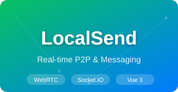

<div align="center">
	
	<h1>LocalSend-Vue</h1>
  <p>基于 WebRTC 和 Socket.IO 的高性能实时通讯平台</p>
</div>

---

## 简介

**LocalSend-Vue** 是一款基于最新前端技术栈（Vue3, Vite6, TypeScript）构建的实时通讯系统。它不仅提供了流畅的即时通讯（IM）体验，更核心地集成了 **WebRTC P2P** 音视频通话技术，实现了低延迟、高可靠的端到端交互。

项目采用 **Monorepo** 架构，将核心逻辑、Hooks、UI 组件等深度解耦，不仅适用于局域网文件秒传，更可扩展为全功能的互联网社交平台。

## 核心特性

- **🚀 WebRTC P2P 通话**：独立封装 WebRTC 服务，支持音视频流采集、SDP 协商及 NAT 穿透（ICE/STUN/TURN），实现极致低延迟的通话体验。
- **💬 实时消息系统**：基于 **Socket.IO** 驱动，支持私聊、群聊、在线状态实时感知及消息状态追踪（发送中/已发送）。
- **🏗️ Monorepo 架构**：使用 **PNPM Workspaces** 搭建，核心模块（Axios、Hooks、Utils）包独立化，代码复用率高，架构清晰。
- **⚡ 极速开发体验**：基于 **Vite6** 和 **UnoCSS**，实现毫秒级热更新与原子化 CSS 构建，极致精简打包体积。
- **🎨 优雅 UI 设计**：集成 **Naive UI**，支持响应式布局、深色模式切换及高度定制化的后台管理界面。
- **🔒 安全可靠**：支持端到端信令加密，提供稳定心跳检测与断线重连机制。

## 技术栈

- **前端框架**：Vue 3.5+ (Composition API)
- **构建工具**：Vite 6
- **实时通讯**：WebRTC + Socket.IO-Client
- **样式引擎**：UnoCSS (Atomic CSS)
- **组件库**：Naive UI
- **状态管理**：Pinia
- **包管理**：PNPM (Monorepo)
- **后端支持**：NestJS + Socket.IO

## 快速开始

### 环境准备

- **NodeJS**: >= 18.20.0
- **PNPM**: >= 8.7.0

### 安装与运行

1. **克隆项目**
   ```bash
   git clone <your-repository-url>
   ```

2. **安装依赖**
   ```bash
   pnpm install
   ```

3. **启动开发环境**
   ```bash
   # 前端启动
   pnpm dev
   
   # 确保配套的 NestJS 后端 (localsend-ws) 已启动
   ```

4. **项目构建**
   ```bash
   pnpm build
   ```

## 项目结构

```text
packages/
  ├── axios/       # 封装的请求库
  ├── hooks/       # 业务逻辑复用钩子
  ├── materials/   # 组件物料库
  └── utils/       # 通用工具函数
src/
  ├── utils/
  │   ├── useWebrtc.ts  # WebRTC 核心逻辑
  │   └── useSocket.ts  # Socket.IO 封装
  └── views/
      └── home/         # 聊天室与交互界面
```

## 核心实现参考

- **WebRTC 协商逻辑**：[useWebrtc.ts](file:///c:/Rouarn/AlibabaCloud/localSend/src/utils/useWebrtc.ts)
- **即时通讯交互**：[chat-room.vue](file:///c:/Rouarn/AlibabaCloud/localSend/src/views/home/modules/chat-room/chat-room.vue)
- **Socket 网关配置**：[websocket.gateway.ts](file:///c:/Rouarn/AlibabaCloud/localsend-WS/src/modules/websocket/websocket.gateway.ts)

## 许可证

[MIT](./LICENSE)
